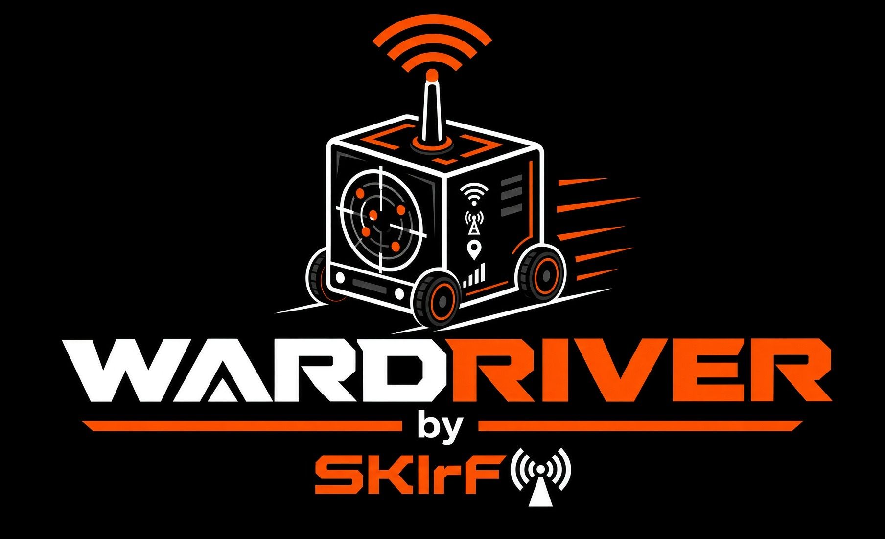
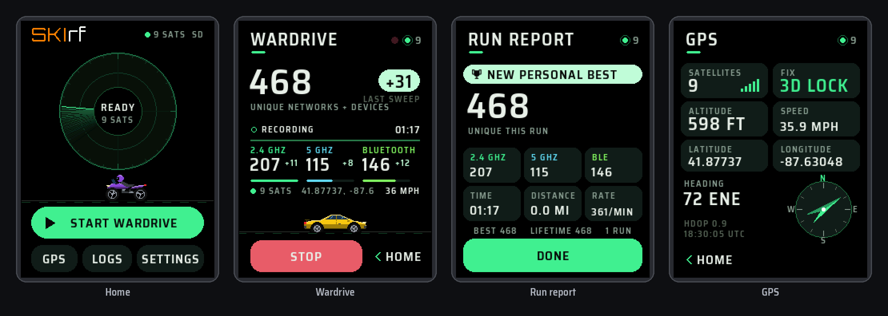
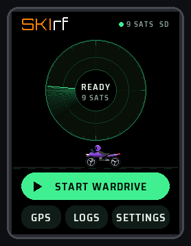
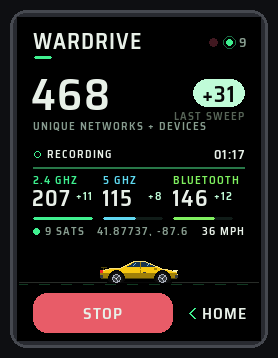
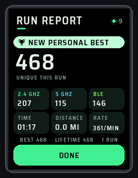
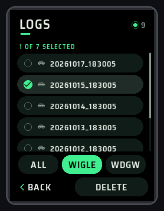
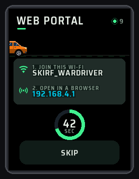

<div align="center">



**Dual-band wardriver for the NM-CYD-C5 ("cheap yellow display", ESP32-C5)**




<sub>Screen pictures are renderings of the interface produced by a simulator, not photographs of the board.</sub>

</div>

## What it is

SKIrf Wardriver turns the NM-CYD-C5 board (ESP32-C5, 2.8 inch touchscreen) into a pocket wardriver. Add a GPS module and a microSD card, pick your ride, and it **listens** for Wi-Fi networks on **both 2.4 GHz and 5 GHz** and for **Bluetooth LE** devices. It logs each one with its position in the **WiGLE CSV format**, and can upload your runs to **WiGLE** and **WDGWars** straight from the board.

It is passive: it only receives the beacons and adverts that devices broadcast openly. It does not connect to, attack, or crack anyone's network.

## Features

- **Dual-band Wi-Fi + Bluetooth LE** in one sweep: 2.4 GHz, 5 GHz (including UNII-3, channels 149-165) and BLE, with a live count for each
- **Pick your ride**: Car, Motorcycle or Walk/Bike profiles tune sweep speed, channel dwell and Bluetooth duty for how fast you are moving (Car sweeps every 2.5 s)
- **Unique counting**: every network or device is counted once per run, and logged again only when you get at least 10 dB closer, which gives WiGLE a better location
- **WiGLE CSV 1.6** logs with frequency, accuracy (from HDOP) and Bluetooth LE rows; a row is only written once the GPS has a fix and a date, so there are no 0,0 points
- **Live dashboard**: big unique counter, "+N" new in the last sweep, 2.4 / 5 / BLE tiles, GPS strip, and your ride driving across the bottom
- **Run report** after each run: totals, time, distance, catch rate, personal best and lifetime total
- **Home radar**: the arm sweeps and every new catch lands as a blip (closer to the middle = stronger)
- **GPS screen** with satellites, fix, altitude, speed, position, heading and a compass; GPS pins can be changed on screen
- **Logs on the board**: select runs, upload to WiGLE or WDGWars over your home Wi-Fi, or delete them
- **Web portal** for 60 seconds at every start (and from Settings): download logs or all as a .zip, upload, delete, and save your Wi-Fi and API keys from a phone or laptop
- **WDGWars stats** on the board
- **Pro mode**: an operator console with RSSI windows, channel plans, GPS gates, scan interval and a live session readout
- Themes (eight accent colours plus WDGW pink + cyan), four screen orientations, brightness presets, drag-to-scroll lists everywhere
- Logs to the microSD card, or to the board's own flash when no card is fitted

<table>
<tr>
<td></td>
<td></td>
<td></td>
<td></td>
<td></td>
</tr>
<tr align="center"><td>Home</td><td>Wardrive</td><td>Run report</td><td>Logs</td><td>Web portal</td></tr>
</table>

## What you need

- An **NM-CYD-C5** board and a USB-C **data** cable
- A **GPS module** wired to the board's GPS connector (for example an ATGM336H; 9600 baud, NMEA; RX on IO4 and TX on IO5 by default, changeable on screen). Scanning starts once the GPS has a fix (4 satellites, 5 on foot); until then the screen says WAITING FOR A GPS FIX.
- A **microSD card**, FAT32, 32 GB or smaller (optional: without one, logs go to the board's flash, about 1.5 MB)
- Optional: a small **passive buzzer** on IO26 for sounds

## Install

Not sure where to start? Read [READ_ME_FIRST.txt](READ_ME_FIRST.txt) and the [help folder](help/).

### Flash the firmware file

1. Download `SKIrf_WARDRIVER_C5_CYD_Beta_1.bin` and `SHA256SUMS.txt` from the [Releases page](https://github.com/SKIrf26/WARDRIVER/releases).
2. Install Python 3, then `pip install esptool`.
3. Plug in the board (left USB-C port) and run:

   ```
   esptool --chip esp32c5 --port YOUR_PORT --baud 460800 write-flash 0x0 SKIrf_WARDRIVER_C5_CYD_Beta_1.bin
   ```
4. The board restarts. The first start asks you to calibrate the touch screen: tap the marker in each of the four corners. The boot screen shows **BETA 1** under the logo.

Writing the image resets saved settings (touch calibration, theme, records). Logs and saved Wi-Fi / API keys on the microSD card stay. Step-by-step help, including checking the download, is in [help/2_FLASHING.txt](help/2_FLASHING.txt).

### Build it yourself

The complete source is in [`src/`](src/). [docs/BUILDING.md](docs/BUILDING.md) lists the libraries, the Arduino IDE settings and the command-line build.

## Documentation

The illustrated user guide covers set-up, every screen, the settings, uploading, troubleshooting and care:

- [User guide (PDF)](docs/SKIrf_WARDRIVER_C5_CYD_Beta_1_User_Guide.pdf)
- Booklet versions for printing two-sided: [flip on long edge](docs/SKIrf_WARDRIVER_C5_CYD_Beta_1_User_Guide_BOOKLET_flip-long-edge.pdf) / [flip on short edge](docs/SKIrf_WARDRIVER_C5_CYD_Beta_1_User_Guide_BOOKLET_flip-short-edge.pdf)
- Plain-text help: [help/](help/) (getting started, flashing, troubleshooting, FAQ)
- For developers: [docs/BUILDING.md](docs/BUILDING.md) and [docs/CODE_MAP.md](docs/CODE_MAP.md)

## Beta status: what to expect

This is **Beta 1**, the first public release. Expect rough edges, and expect some behaviour to change.

- A run scans and logs only while the GPS has a fix. Give the module a clear view of the sky; the first fix can take a few minutes.
- The web portal's hotspot (`SKIrf_WARDRIVER`) is **open** (no password) for the 60 seconds it is up. Do not leave it running in a crowded place. See [SECURITY.md](SECURITY.md).
- The Wi-Fi country is set to US in the source (`SKIRF_WIFI_COUNTRY`), which allows 5 GHz channels 149-165. Change it and build your own if you are elsewhere.
- Sound needs a small **passive** buzzer fitted to the board.

Found a problem? Open an issue with the **Bug report** form and include what the Serial Monitor (115200 baud) printed.

## Responsible use

Wardriving records the wireless networks and devices that broadcast openly around you. Receiving those broadcasts is lawful in many places, but laws differ. You are responsible for following the laws where you are. Never connect to networks you are not allowed to use. Do not use the logs to identify, follow or harass people. **Do not operate the screen while driving**: start a run before you set off, or have a passenger use it.

## Licence

SKIrf Wardriver is free software released under the **GNU General Public License v3.0**; see [LICENSE](LICENSE). It comes with **no warranty**. Copyright (C) 2026 SKIrf Labs.

It is built with third-party components under their own licences (LGPL, Apache 2.0, BSD, MIT, SIL OFL): see [THIRD_PARTY_NOTICES.md](THIRD_PARTY_NOTICES.md).

WiGLE, WDGWars, RockBase, NMTech, Espressif, Arduino and other names belong to their owners. This project is not affiliated with, or endorsed by, any of them.

## Project files

| Path | Contents |
|---|---|
| `src/` | The firmware source (Arduino sketch) |
| `help/` | Plain-text help: getting started, flashing, troubleshooting, FAQ |
| `firmware/` | How the release `.bin` is flashed and checked |
| `docs/` | User guide PDFs, build notes, code map, release steps, images |
| `tools/` | Script that turns a build into the release `.bin` and checksum; `tools/art/` makes the sprites, icons and fonts |
| `licenses/` | Licence texts of the third-party components |
| `CHANGELOG.md`, `RELEASE_NOTES.md` | What is in each release |
